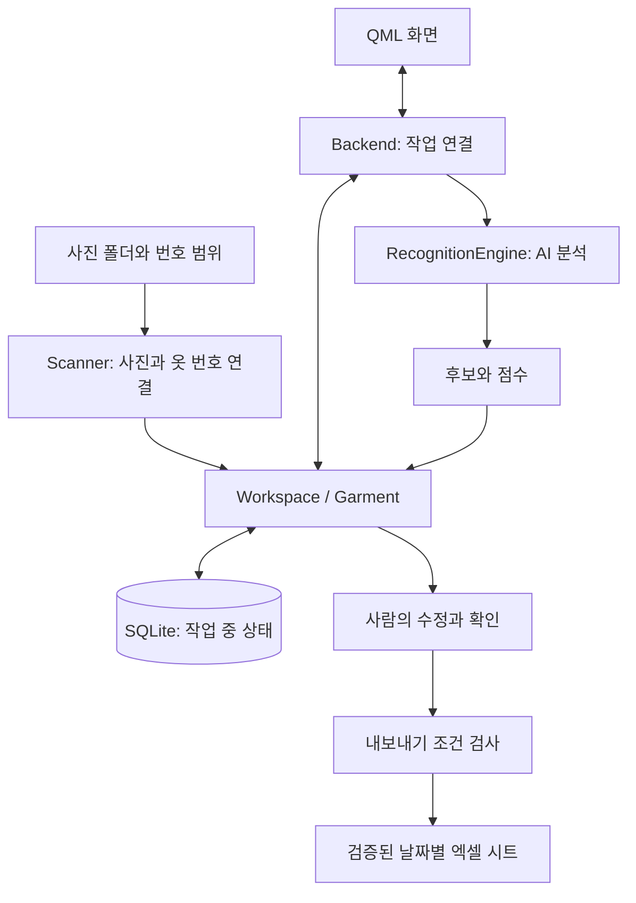

# 외투작업실 공부 목록을 실제 코드로 이해하기

작성일: 2026-11-23 · 최종 앱 기준: 2.6.4

이 글은 기존 「외투작업실 포트폴리오 공부 가이드」의 공부 순서를 자세히 풀어 쓴 설명서다. Python이나 AI 용어를 먼저 외우기보다, 사진 한 벌이 들어와 검수된 엑셀 한 행이 되는 과정을 따라가며 기술이 필요한 이유를 이해하는 것을 목표로 한다. 각 절의 코드 링크는 이 저장소에 있는 구현을 가리킨다. 예시로 쓴 짧은 코드는 개념을 설명하기 위한 것이며 운영 DB에서 실행하는 명령이 아니다.

기존 가이드는 2.6.3 시점의 자료이므로 아동 60과 카테고리 개선을 다음 과제로 적었다. 최종 2.6.4에서는 **첫 20종 사이즈 후보를 채택하고, 카테고리는 기존 모델을 유지**했다. 희소 사이즈 추가 학습 후보와 새 카테고리 후보는 최종 설치물에 넣지 않았다. 이 차이를 알고 읽어야 과거 계획과 완성된 앱을 혼동하지 않는다.

## 1. 먼저 설명할 수 있어야 하는 것: 이 앱이 해결한 업무

이 앱을 “AI가 옷을 분류하는 프로그램”이라고만 설명하면 업무의 절반이 빠진다. 실제 작업자는 사진 번호를 찾고, 안내판을 읽고, 옷 종류를 확인하고, 틀린 값을 고치고, 작업을 중단했다 이어 하고, 날짜별 엑셀에 결과를 추가해야 한다. 분류기의 정답률이 높아도 사람이 고친 값을 잃거나 기존 엑셀을 훼손하면 실무에 사용할 수 없다.

따라서 이 프로젝트의 중심은 **AI의 제안을 사람이 검수한 업무 데이터로 바꾸는 흐름**이다. 사진 탐색, 분류 제안, 확인 필요 표시, 수동 수정, 자동 저장, 엑셀 내보내기가 하나의 작업으로 이어진다. 프로그램을 공부할 때도 신경망 구조부터 시작하기보다 이 흐름에서 출발하는 것이 이해하기 쉽다.

예를 들어 아동 안내판에 `60`이 있는데 AI가 `90`이라고 읽었다고 하자. 여기에는 서로 다른 문제가 있다. 모델의 출력 목록에 60이 없는 문제, 잘못 읽은 값이 높은 점수를 얻는 문제, 작업자가 고친 값을 재분석이 덮어쓰는 문제, 잘못된 값을 엑셀로 보내는 문제가 각각 있다. 모델 재학습은 첫 번째와 두 번째 문제에 관여한다. 입력 보호와 검수 조건은 세 번째와 네 번째 문제를 다룬다.

한 문장으로 설명하면 다음과 같다.

> 외투작업실은 촬영 사진의 분류 후보를 로컬 AI로 제안하고, 사람이 수정·확인한 결과를 보존해 날짜별 엑셀 시트에 저장하는 Windows 앱이다.

코드의 출발점은 [사용 흐름](../README.md)과 [요구사항 인계](../REBUILD_HANDOFF.md)다. 기능을 설명할 때는 “버튼이 있다”에서 끝내지 말고, 그 버튼이 어떤 업무 실수를 줄이는지까지 연결한다. 실제 수작업 대비 시간 절감률은 별도 비교 측정 없이 주장하지 않는다.

## 2. 프로그램을 여섯 부분으로 나누어 보기

전체 코드를 한 번에 읽으면 파일 수에 압도되기 쉽다. 우선 책임을 여섯 부분으로 나누면 읽을 범위가 줄어든다.

| 부분 | 맡는 일 | 먼저 읽을 파일 |
|---|---|---|
| 화면 | 사진·입력칸·메뉴·상태를 표시 | [Main.qml](../coatdesk_v2/qml/Main.qml) |
| 화면과 작업 연결 | 버튼 요청을 받아 작업을 시작하고 화면에 결과 전달 | [backend.py](../coatdesk_v2/backend.py) |
| 업무 규칙 | 필수 입력, 확인 필요, 수동 입력 보호, 내보내기 가능 여부 | [domain.py](../coatdesk_v2/domain.py) |
| 저장 | 작업공간·옷별 상태·설정을 SQLite에 보관 | [storage.py](../coatdesk_v2/storage.py) |
| 사진 분석 | 모델 실행, 전처리, 결과 조합, 캐시 식별 | [recognition.py](../coatdesk_v2/recognition.py) |
| 결과 파일 생성 | 엑셀 미리보기·검증·기존 파일에 시트 추가 | [excel.py](../coatdesk_v2/excel.py) |

다음 그림에서 화살표는 데이터를 전달하거나 기능을 호출한다는 뜻이다. 모든 일이 화면 안에서 처리되는 구조가 아니다.



이렇게 나누는 이유는 수정의 영향을 좁히기 위해서다. 2.6.4에서 사이즈 모델을 추가할 때 엑셀 저장이나 QML 배치를 바꾸지 않아도 됐다. 필요한 변경은 새 클래스 순서를 받아들이는 로더와 모델 자산 준비에 집중됐다. 책임이 나뉘어 있으면 “모델만 바꾸고 나머지는 유지한다”는 요구를 코드 차이와 테스트로 확인할 수 있다.

직접 해볼 일은 엑셀 저장 버튼 하나를 고르는 것이다. 화면에서 어떤 Python 메서드를 부르는지, 그 메서드가 어떤 업무 규칙과 저장 기능을 사용하는지 순서대로 적어 본다. 파일 내용을 전부 읽는 것보다 호출 경로 하나를 완성하는 편이 먼저다.

## 3. Python 기초: 변수보다 데이터의 의미부터 이해하기

### 3.1 문자열, 숫자, 딕셔너리

옷 번호 `0007`은 계산할 수량이 아니라 식별자다. 이를 정수 7로만 저장하면 앞의 0을 잃는다. 프로그램에서는 화면과 엑셀에 보존할 코드와 번호 범위를 비교할 숫자의 역할을 구별해야 한다. “숫자로 보이는 값은 모두 숫자형으로 저장한다”는 접근이 항상 맞는 것은 아니다.

딕셔너리는 이름과 값을 연결한다. 옷 한 벌의 `fields`에는 `category`, `gender`, `age`, `size` 같은 이름으로 현재 입력값이 들어간다. 반면 `suggestion`에는 AI 후보와 점수, 판넬 위치, 확인 사유 같은 분석 결과가 들어간다. 둘을 같은 딕셔너리 하나로 취급하면 AI가 제안한 값과 사람이 결정한 값을 구별하기 어려워진다.

```python
fields = {"category": "코트", "gender": "여성", "age": "성인", "size": "S"}
suggestion = {"values": {"size": "M"}, "scores": {"size": 0.94}}
```

이 예에서 현재 저장할 사이즈는 S이고 AI 후보는 M이다. 점수 0.94만 보고 `fields`를 M으로 덮어쓰면 사람이 수정한 결과를 잃을 수 있다. 자료구조를 이해한다는 것은 문법을 외우는 것뿐 아니라 각 값의 권한과 출처를 구별한다는 뜻이다.

### 3.2 클래스와 dataclass

[domain.py](../coatdesk_v2/domain.py)의 `Garment`는 옷 한 벌의 자료와 규칙을 묶는다. `Workspace`는 특정 날짜·폴더·번호 범위에 속한 작업을 나타낸다. `dataclass`는 이런 자료 중심 클래스에서 초기화와 표현 같은 반복 코드를 줄여 준다. 다만 dataclass를 썼다고 값이 자동으로 올바르게 검증되는 것은 아니다. 허용 사이즈인지, 확인이 필요한지 같은 조건은 별도 코드가 판단한다.

`Garment`에 입력값 외에 `field_sources`, `reviewed_values`, `analysis_key`가 있는 이유를 생각해 보자. 값만 저장하면 “M이라고 적혀 있다”는 사실만 알 수 있다. 출처를 저장하면 “AI가 넣은 M인지 사람이 고른 M인지”를 구별한다. 확인 당시 값을 저장하면 “현재 M이라는 값에 대한 확인이 아직 유효한지”도 판단할 수 있다.

`@property`는 이런 자료에서 계산되는 상태를 속성처럼 읽게 한다. `export_ready`는 단순히 화면 버튼이 눌렸는지를 저장한 값이 아니다. 필수 입력이 완성됐는지와 필요한 검수가 남아 있는지로 계산된다. 그래서 다른 화면에서 같은 옷을 보더라도 같은 업무 규칙을 사용할 수 있다.

### 3.3 함수, 타입 힌트, 예외

함수는 한 작업을 이름 붙여 묶은 것이다. `confirm_review()`라는 이름은 단순한 체크박스 변경보다 강한 의미를 갖는다. 이 함수는 필수값과 허용값을 확인한 뒤 현재 입력에 대한 사람 확인을 기록한다. 함수 이름과 내부 조건을 함께 읽어야 실제 계약을 이해할 수 있다.

`path: Path` 같은 타입 힌트는 개발자가 기대하는 자료의 종류를 알려 준다. 일반적인 Python 실행에서 힌트 자체가 모든 입력을 검사해 주는 것은 아니다. 화면 입력, 외부 JSON, 파일에서 온 값에는 실제 검증이 필요하다.

예외는 정상적으로 진행할 수 없는 상황을 알리는 수단이다. 사진이 없을 때, 허용하지 않는 사이즈일 때, 엑셀 파일이 바뀌었을 때를 모두 성공으로 처리하면 오류를 숨기게 된다. 반대로 한 사진의 카테고리 분석이 실패했다고 이미 얻은 판넬 결과까지 버릴 필요도 없다. 어디에서 실패를 막고 어디에서 부분 결과를 남기는지가 설계의 일부다.

**이 절의 확인 질문:** `suggestion["values"]["size"]`가 바뀌었다고 현재 입력 사이즈도 항상 바뀌어야 할까? 답은 아니다. 기존 입력값과 출처, 확인 상태를 함께 봐야 한다.

## 4. 파일, 경로, JSON, 해시를 함께 공부해야 하는 이유

사진은 프로그램 DB 안에 통째로 들어가는 것이 아니다. 스캐너는 폴더에서 옷 번호와 사진 방향을 찾아 연결하고, 작업에는 사진을 다시 찾을 경로 정보가 남는다. 이 구조 덕분에 DB를 저장할 때 매번 큰 이미지까지 복사하지 않아도 된다. 대신 원본 폴더를 옮기면 경로를 다시 연결하는 기능이 필요하다.

[scanner.py](../coatdesk_v2/scanner.py)를 볼 때는 “번호가 아예 없는 경우”, “번호 폴더는 있지만 사진이 없는 경우”, “일부 방향 사진만 있는 경우”를 구별한다. 업무 화면에서 이 셋을 모두 같은 누락으로 처리하면 실제 무엇을 보완해야 하는지 알 수 없다. 번호 범위를 줄였다가 다시 늘릴 때 기존 기록을 버리지 않는 것도 같은 맥락이다.

`Path`는 경로를 다루는 객체다. 문자열에 `/`나 `\`를 직접 이어 붙이는 것보다 부모 폴더, 확장자, 상대 경로 같은 의미를 드러내기 쉽다. 사용자 폴더에서 온 경로는 의도한 범위를 벗어나지 않는지도 확인해야 한다. 파일명처럼 보이는 문자열이 언제나 안전한 사진 경로인 것은 아니다.

JSON은 딕셔너리와 리스트 같은 자료를 텍스트로 저장하는 형식이다. 설정, 모델 manifest, 분석 결과 기록을 읽을 때 자주 보게 된다. JSON으로 저장할 수 있다는 것과 그것을 신뢰할 수 있다는 것은 다르다. 클래스 순서가 맞는지, 필수 키가 있는지, 파일 해시가 일치하는지 같은 검증이 따로 필요하다.

SHA-256은 파일 내용에서 계산하는 지문이다. 파일 이름이 같아도 내용이 바뀌면 대조를 통해 이를 발견할 수 있다. 앱은 모델 파일의 해시를 manifest와 비교한다. 캐시도 사진 내용과 모델 정보를 반영한다. 모델 학습·합성 작업에서는 원본 사진을 바꾸지 않았는지 확인하는 데 해시를 사용했다.

해시가 같다는 사실은 파일 내용이 같다는 증거이지, 그 모델이 정확하다는 증거는 아니다. 또한 공격자가 파일과 비교할 해시를 함께 바꾸는 상황까지 막는 디지털 서명과는 다르다. 해시 대조, 정확도 평가, 실제 실행은 서로 다른 질문에 답하는 검사다.

## 5. PySide6와 QML: 화면과 Python은 어떻게 대화하는가

### 5.1 선언형 화면이라는 뜻

QML에서는 버튼, 색상, 글자, 배치, 화면 상태를 선언한다. “이 버튼을 이 좌표에 그린 다음 글자를 다시 그려라”를 매번 직접 지시하기보다, 화면 요소와 그 속성이 어떤 값에 연결되는지를 적는다. 값에 연결된 속성을 바인딩이라고 생각하면 된다.

예를 들어 확인이 필요한 옷일 때 카드 테두리를 바꾸려면, 화면은 업무 코드가 계산한 확인 상태를 읽어 표시하면 된다. 화면 파일 안에서 모델 점수, 수동 수정 출처, 아동 성별 예외를 다시 모두 계산할 필요가 없다. 같은 규칙을 Python과 QML 양쪽에 복사하면 나중에 한쪽만 바뀌는 문제가 생기기 쉽다.

### 5.2 QObject, Slot, Signal

PySide6는 Qt 기능을 Python에서 사용하게 해 준다. `Backend(QObject)`는 화면과 Python 작업을 연결하는 객체다. `@Slot`이 붙은 메서드는 Qt의 호출 체계에 노출되는 진입점이다. `Signal`은 상태 변화나 이벤트를 전달한다.

개념적으로는 화면의 클릭이 `startAnalysis(False)` 같은 메서드로 들어가고, Backend가 작업을 시작한 뒤 변경 신호를 보내며, QML이 새 상태를 읽어 다시 표시하는 흐름이다. 버튼이 직접 SQLite SQL이나 신경망 연산을 모두 실행하는 구조로 이해하면 안 된다.

[__main__.py](../coatdesk_v2/__main__.py)에서 QML 엔진에 `appBackend`를 연결하는 부분을 찾고, [backend.py](../coatdesk_v2/backend.py)에서 같은 이름으로 호출되는 메서드를 찾아보면 연결이 구체적으로 보인다. [Main.qml](../coatdesk_v2/qml/Main.qml)부터 모든 파일을 읽기보다 실제 버튼 하나를 따라가면 된다.

### 5.3 목록 모델과 화면 갱신

많은 옷을 화면에 표시할 때는 데이터 목록을 Qt의 모델로 제공한다. `PageModel`은 현재 페이지에서 그릴 옷의 정보와 역할을 QML에 전달한다. 사용자가 2×2에서 4×4로 바꾸면 사진과 입력 카드 수, 현재 페이지의 범위가 함께 달라진다.

여기서 공부할 중요한 개념은 화면 요소와 영구 데이터를 분리하는 것이다. 카드가 화면에서 사라졌다고 옷 기록을 삭제하는 것이 아니고, 필터에 걸려 보이지 않는다고 작업 대상 자체가 사라지는 것도 아니다. 전체 작업, 현재 필터 결과, 현재 페이지를 각각 구별해야 한다.

테마도 같은 원리로 볼 수 있다. 테마는 화면에 적용하는 상태이고 마지막 선택은 설정에 저장한다. QML 속성이 그 상태에 연결되면 여러 요소가 함께 바뀐다. 다만 파일에 색상을 바꿨다는 사실만으로 확대창, 팝업, 최소 창 크기에서도 읽기 좋은지까지 확인되는 것은 아니다. 실제 UI 테스트가 필요하다.

**직접 해볼 일:** 분석 버튼의 호출 이름, Backend의 처리 메서드, 화면을 갱신하는 신호를 각각 하나씩 찾는다. “클릭 → Python 작업 → 상태 변경 → 화면 갱신”을 네 문장으로 설명하면 된다.

## 6. SQLite: 작업 기록이 엑셀과 별도로 필요한 이유

엑셀은 최종 결과를 전달하는 파일이고, SQLite는 작업 중 상태를 보관하는 저장소다. 옷을 검수하다 앱을 종료해도 입력과 확인 상태를 이어가야 한다. 사용자가 아직 내보내지 않은 작업도 있으므로 앱 복원을 엑셀 파일에 의존할 수 없다.

[storage.py](../coatdesk_v2/storage.py)의 테이블을 보면 역할을 확인할 수 있다. `workspaces`는 작업 이름·촬영일·사진 폴더·번호 범위를 담고, `garments`는 그 작업에 속한 옷을 담는다. `settings`에는 앱 설정을, `exports`에는 내보내기 관련 기록을 저장한다. 어떤 시점에 테이블이 존재한다는 것과 그 테이블을 현재 엑셀 저장 경로가 매번 어떻게 사용하는지는 별도 코드로 확인한다.

작업 ID와 옷 번호를 함께 쓰는 이유도 중요하다. 다른 날짜의 작업에 같은 옷 번호 `0001`이 있을 수 있다. 옷 번호만으로 수정 대상을 찾으면 엉뚱한 작업을 바꿀 위험이 있다. 데이터베이스의 키는 현실에서 무엇을 하나로 구별해야 하는지 표현한다.

옷 payload 일부를 JSON으로 저장하면서 SQLite를 쓰는 것은 모순이 아니다. SQLite가 작업과 옷의 관계, 조회와 트랜잭션을 맡고, JSON payload가 옷별 여러 상태를 담는다. 모든 세부 항목이 각각 SQL 열인 구조는 아니다. 이 선택은 상태 묶음을 저장하기 쉽지만, 특정 세부 필드만 대상으로 복잡한 SQL 분석을 하려면 추가 설계가 필요할 수 있다.

트랜잭션은 관련 변경을 하나의 성공·실패 단위로 묶는다. 사이즈 값은 바뀌었는데 확인 당시 값은 그대로 남는 식의 중간 상태가 저장되면 안 된다. `Repository.edit()`는 현재 옷을 읽고 업무 규칙으로 변경한 뒤 payload와 작업 revision을 같은 DB 작업 안에서 갱신한다.

코드의 WAL 설정은 쓰기 기록을 별도 로그에 관리하는 SQLite 동작 방식이다. 읽기와 쓰기의 동시성에 도움이 되지만, 여러 쓰기 작업을 아무 제한 없이 동시에 안전하게 수행한다는 뜻은 아니다. 연결, 트랜잭션, 잠금, 사용자 동작 제한을 함께 봐야 한다. 이 앱의 SQLite를 여러 PC에서 동시에 쓰는 공유 서버 DB처럼 설명하지 않는다.

**자가 질문:** 앱을 다시 켰을 때 이전 작업을 찾기 위해 반드시 엑셀을 열어야 할까? 아니다. 작업 DB와 설정을 읽는다. 엑셀은 검수 결과를 내보내는 별도 산출물이다.

## 7. 오래 걸리는 AI 분석과 화면을 분리하기

화면은 클릭, 키보드, 창 크기 변경 같은 이벤트를 계속 처리해야 한다. 그 흐름에서 수백 장의 신경망 연산을 동기적으로 끝까지 수행하면 화면이 멈춘 것처럼 보인다. 따라서 오래 걸리는 분석을 화면 처리와 분리한다.

현재 [backend.py](../coatdesk_v2/backend.py)는 일반 작업에 Qt의 작업 풀을 사용하고, 인식 작업에는 전용 `ThreadPoolExecutor`를 사용한다. 인식 작업은 한 작업자에서 순차 실행하며 모델 엔진을 재사용한다. “백그라운드로 실행한다”를 “사진 수만큼 스레드를 무제한 만든다”로 이해하면 안 된다. CPU 자원과 모델 메모리를 고려해 동시 실행 범위를 제한하는 것이다.

분석 작업은 진행 이벤트를 보내고 화면은 Qt 신호를 통해 전달받는다. 백그라운드 작업이 화면의 모든 요소를 직접 바꾸는 방식보다 역할이 명확하다. 여기서 스레드를 사용한다는 이유만으로 모든 Python 코드가 여러 CPU 코어에서 비례해서 빨라진다고 말할 수는 없다. UI 응답성을 유지하는 문제와 실제 연산 처리량을 늘리는 문제를 나눠 생각한다.

### 7.1 작업 A의 결과가 작업 B를 덮어쓰면 안 된다

작업 A를 분석하다 사용자가 작업 B를 열 수 있다. 이때 늦게 도착한 A의 결과를 “지금 열린 화면”에 무조건 넣으면 B에 A의 옷이 섞인다. 그래서 이벤트와 저장에 작업 ID가 필요하다. 현재 화면의 작업과 결과의 작업이 같은지 확인하고, 저장은 분석을 시작한 작업에 해야 한다.

### 7.2 늦게 도착한 이벤트보다 사람의 최신 입력을 우선한다

시간 순서를 다음처럼 생각해 보자. 분석이 시작되고, 사용자가 사이즈를 L로 수정하고, 그 이전 시점에 만들어진 분석 진행 이벤트가 화면에 도착한다. 오래된 이벤트가 들고 온 상태를 그대로 표시하면 사람의 수정이 사라진 것처럼 보일 수 있다.

현재 진행 이벤트 처리에서는 해당 옷의 최신 저장값을 다시 읽어 반영한다. 또한 분석 결과를 저장할 때도 현재 옷에 업무 규칙을 적용한다. 화면 갱신과 DB 저장 양쪽에서 “어느 시점의 데이터인가”를 신경 써야 경쟁 상황을 줄일 수 있다.

### 7.3 중단은 강제 종료와 다르다

분석 중단은 취소 신호를 보내 다음 옷을 처리하기 전에 확인하게 한다. 현재 처리 중인 한 벌을 마치고 저장한 뒤 중단하면 완료한 결과가 남는다. 신경망 연산 중간에 프로세스를 무조건 죽이는 것과는 다르다. 다시 시작할 때 유효한 결과를 재사용하는 캐시가 이 흐름과 연결된다.

이 절의 핵심은 스레드 이름보다 **결과의 소유 작업, 데이터의 최신성, 중단 경계**다. 면접에서는 이 세 가지를 실제 작업 전환 사례로 설명하는 편이 좋다.

## 8. AI 제안과 사람의 확정: 값만 저장해서는 부족하다

모델이 `M`을 제안하고 사용자가 `S`로 고쳤다면 두 정보는 함께 보존할 가치가 있다. 현재 업무 데이터는 S여야 하지만 AI가 무엇을 냈는지를 알아야 오분류를 분석할 수 있다. 이 때문에 후보와 현재 입력, 입력 출처를 나누어 관리한다.

현재 `Garment.apply_analysis()`는 성별·연령·사이즈의 빈 입력에 후보를 채운다. 이미 있는 값을 재분석으로 무조건 덮어쓰지 않는다. 카테고리는 출처가 임시 기본값이나 아직 AI 출처인 경우의 갱신 규칙이 따로 있고, 수동·확인한 값은 보호한다. 모든 필드를 단순히 “새 결과로 업데이트”하는 구현이 아니다.

확인도 옷 전체의 불변한 도장이 아니다. 사람이 S라는 값을 보고 확인했는데 나중에 M으로 바꾸면, S에 대한 확인으로 M을 내보내서는 안 된다. `reviewed_values`가 확인 당시 값을 보관하는 이유다. 값을 바꾸면 관련 확인을 다시 판단한다.

`export_ready`는 필수값 완성과 필요한 검수 완료를 함께 확인한다. 모델이 높은 점수를 냈다는 사실만으로 항상 내보낼 수 있는 것도 아니고, 모든 정상 항목에 사람이 별도 확인 버튼을 눌러야 하는 것도 아니다. 현재 규칙에서 확인이 필요한 항목만 확인하도록 흐름을 구성했다.

아동 성별이 대표적인 예외다. 현재 성별·연령 모델의 출력은 `adult_male`, `adult_female`, `child` 세 종류다. 아동을 남아·여아로 나누는 출력은 없다. 앱은 아동 성별을 기본 입력하고 필수 확인을 요구한다. 따라서 “아동 65장을 정확히 판별했다”는 결과를 “아동 남녀를 65장 모두 맞혔다”로 바꾸어 말하면 안 된다.

직접 상태를 적어 보자. 사이즈 점수가 기준 미달이라 확인이 필요한 옷에서 사용자가 값을 고른 상황과, 그 값을 보고 확인까지 마친 상황은 다르다. 이후 다른 값으로 바꾸면 확인이 어떻게 무효화되는지 [domain.py](../coatdesk_v2/domain.py)의 `set_field()`, `pending_review`, `confirm_review()`를 연결해 읽는다.

## 9. 네 AI 모델이 각각 무엇을 보는가

최종 앱은 네 개의 학습 모델을 연결한다. “AI 모델”이라는 이름 아래 입력과 역할이 다른 기능을 구별해야 한다.

| 모델 | 주로 보는 정보 | 출력과 사용 |
|---|---|---|
| 판넬 검출 | 전체 정면 사진 | 판넬 위치와 점수, 잘라낼 영역 |
| 성별·연령 분류 | 잘라낸 판넬 | 성인 남성·성인 여성·아동 |
| 사이즈 분류 | 잘라낸 판넬 | 안내판에 적힌 20종 원문 사이즈 |
| 카테고리 분류 | 안내판을 가린 전체 옷 사진 | 소매 유무와 기장, 이후 정책으로 표시 분류 결정 |

판넬 검출은 “사진 어디를 볼 것인가”를 정한다. 분류는 정해진 입력에서 “어느 이름에 해당하는가”를 고른다. 판넬을 잘못 자르면 성별과 사이즈 분류가 함께 영향을 받을 수 있다. 따라서 최종 결과만 보지 말고 판넬 위치, 잘라낸 이미지, 원문 출력, 표시값을 단계별로 확인할 수 있어야 한다.

[model.py](../coatdesk_locator/model.py)의 검출기는 torchvision의 SSDLite/MobileNet 계열 구조를 사용한다. 함수 이름에 들어 있는 입력 크기 숫자와 실제 앱의 입력 크기를 같다고 추정하면 안 된다. [ai_runtime.py](../coatdesk_v2/ai_runtime.py)는 검출기 실행 크기를 448로 고정한다. 성별·사이즈 판넬 입력은 512이며, 카테고리 입력은 320이다. 이런 값은 기억보다 실행 코드와 manifest에서 확인한다.

성별·사이즈 모델은 [PhotoClassifier](../coatdesk_ab/network.py)를 사용한다. ResNet18 특징 추출부의 마지막 축소 정도를 조정하고 학습된 공간 가중치로 특징을 모은다. 카테고리는 [category.py](../coatdesk_v2/category.py)의 EfficientNet-B0 기반 모델이다. 모델을 나눴다는 이유로 모든 특징이나 가중치를 공유하는 멀티태스크 모델이 되는 것은 아니다.

판넬을 먼저 찾는 방식은 위치 오류를 따로 조사하고 작은 글자에 집중하기 쉽다는 장점이 있다. 대신 앞 단계의 오류가 뒤로 전달될 수 있다. 전체 사진을 한 번에 분류하는 대안도 있지만, 어떤 방식이 더 나은지는 실제 사진과 측정 결과로 비교해야 한다. 이 프로젝트에서 선택한 구조를 모든 문제에 보편적으로 가장 좋은 구조라고 설명하지 않는다.

## 10. 텐서, 전처리, attention을 처음부터 이해하기

### 10.1 사진이 숫자로 바뀌는 과정

컴퓨터에서 RGB 사진은 픽셀마다 빨강·초록·파랑 값을 가진 배열이다. 이미지 라이브러리에서 흔히 다루는 모양은 높이×너비×채널이고, PyTorch 모델에는 채널×높이×너비로 바꾼 뒤 여러 장을 묶는 배치 차원을 더한다. 예를 들어 512 크기 RGB 판넬 한 장은 모델에 들어갈 때 대체로 `1×3×512×512` 모양이 된다.

픽셀 값을 0~255 정수 그대로 쓰는 대신 255로 나누고 정해진 평균과 표준편차로 정규화한다. 모델은 이런 입력 형태를 기준으로 학습됐다. 가중치만 맞고 입력 채널 순서, 크기, 정규화가 다르면 같은 사진도 다른 숫자 배열이 되어 성능이 달라질 수 있다.

### 10.2 letterbox와 잘라내기의 차이

정사각형 입력을 만들려고 사진을 강제로 가로세로 늘리면 글자나 옷의 비율이 바뀐다. 반대로 중앙만 잘라내면 소매나 밑단을 잃을 수 있다. letterbox는 원래 비율을 유지해 크기를 맞추고 남는 공간을 채우는 방법이다.

사이즈 판넬에서는 글자의 형태를 유지하는 것이 중요하다. 카테고리에서는 소매와 전체 기장 정보를 남기는 것이 중요하다. 따라서 같은 크기 변환이라도 어떤 정보가 없어지는지 따져야 한다. 증강에서 무조건 큰 자르기를 쓰지 않은 이유도 여기에 연결된다.

### 10.3 CNN의 특징과 공간 가중치

신경망의 앞부분은 픽셀에서 여러 특징 지도를 만든다. 뒤쪽에서는 이 특징을 모아 클래스별 점수를 만든다. `PhotoClassifier`의 attention은 특징 지도 위치마다 가중치를 주고 합치는 부분이다. 배경보다 판넬 글자와 관련된 위치를 더 사용할 수 있도록 학습되는 것이다.

코드에서는 특징 지도의 공간 위치에 softmax를 적용해 가중치를 만들고, 그 가중치와 특징을 곱해 합친 뒤 최종 Linear 층에 넣는다. 이 attention을 사용한다고 모델이 Transformer나 대형 언어 모델이 되는 것은 아니다. 또한 가중치 지도가 보인다고 그것만으로 모델 판단의 완전한 인과 설명이 되는 것도 아니다.

### 10.4 logit과 softmax

최종 Linear 층은 클래스마다 logit이라는 점수를 낸다. softmax는 이 점수들을 서로 비교 가능한 확률 모양의 값으로 변환한다. 가장 큰 값에 해당하는 클래스가 원문 후보가 된다.

중요한 점은 softmax가 정답을 새로 만들어 주지 않는다는 것이다. 출력 클래스에 60이 없으면 모델은 아무리 선명한 60 사진을 보아도 60이라는 이름을 고를 수 없다. 또 softmax 99%는 비슷한 사진 100장 중 반드시 99장을 맞힌다는 보장이 아니다. 데이터 분포가 달라지거나 학습이 잘못되면 높은 점수로 틀릴 수 있다.

## 11. 사이즈 18종에서 20종으로 늘릴 때 실제로 바뀐 것

기존 사이즈 분류기에 없는 `60`과 성인 문자 `2XS`를 추가하려면 화면 선택 항목 하나만 늘리는 것으로 끝나지 않는다. 모델의 마지막 출력 수, 각 출력 번호가 뜻하는 클래스, 학습 라벨, 저장된 가중치, 앱 로더가 같은 계약을 가져야 한다.

최종 20종 순서는 다음과 같다.

```text
60, 70, 80, 90, 100, 110, 120, 130, 140, 150, 160, 170,
2XS, XS, S, M, L, XL, 2XL, 3XL
```

배열의 0번째, 1번째 같은 위치는 자체로 사이즈 이름을 담지 않는다. 모델이 출력한 0번째 값을 60으로 해석할지 70으로 해석할지는 클래스 순서가 정한다. 순서가 틀려도 숫자 계산 자체는 정상적으로 끝날 수 있어 위험하다. 그래서 2.6.4 로더는 지원하는 정확한 순서인지 확인한다.

학습 초기화에서도 이름으로 대응해야 한다. 맨 앞에 60이 추가되면 이전 70의 위치가 달라진다. 예전 행을 위치 그대로 복사하면 70을 배운 가중치가 60이라는 이름으로 연결될 수 있다. [size_retrain_20261122_fit.py](../scripts/size_retrain_20261122_fit.py)의 클래스 이름 대응과 [계약 테스트](../tests/test_size_retrain_20261122.py)를 함께 읽으면 이 문제를 볼 수 있다.

원문과 앱 입력값도 구별한다. 아동 원문 60과 70은 기존 업무 변환표에서 모두 2XS로 저장한다. 따라서 원문 60을 70으로 잘못 읽어도 최종 입력값은 같을 수 있다. 사이즈 판독 모델을 평가할 때 원문 정확도와 업무 변환 후 정확도를 따로 기록해야 하는 이유다.

이 모델은 옷의 실제 치수를 재어 사이즈를 추정하는 모델이 아니다. 안내판에 적힌 사이즈를 분류한다. 여성 S 옷의 안내판 글자만 2XS로 바꾼 합성은 **안내판 판독 과제**의 자료가 될 수 있다. 그것이 실제 옷이 2XS라는 치수 검증 자료가 되는 것은 아니다.

## 12. 학습의 기본 단위: 한 번 보고, 틀린 정도를 계산하고, 가중치를 바꾸기

학습은 사진과 정답을 모델에 넣어 예측하고, 정답과 얼마나 다른지 손실을 계산한 뒤, 그 손실을 줄이는 방향으로 가중치를 바꾸는 반복이다. 이 흐름을 forward, loss, backward, optimizer update로 나눠 읽으면 된다.

batch는 한 번에 처리하는 사진 묶음이다. epoch는 해당 학습 절차가 정의한 데이터 묶음을 한 바퀴 도는 단위다. epoch가 늘었다고 새로운 옷이 늘어나는 것은 아니다. 같은 사진을 여러 번 보며 가중치를 조정한다. 이 프로젝트는 학습 시 원본과 증강 관측을 구별해 기록했다.

사이즈 학습의 cross entropy는 정답 클래스에 높은 점수를 주도록 유도한다. 하지만 손실 하나가 줄어드는 것만으로 실제 처음 보는 사진에 좋아졌다고 결론 낼 수 없다. 별도 개발 데이터와 최종 평가가 필요하다. 학습 사진을 기억하는 과적합도 가능하기 때문이다.

현재 첫 20종 학습 코드는 기존 모델을 teacher로 사용해 공통 클래스에 대한 출력 분포를 보존하려는 손실도 사용한다. 이를 지식 증류라고 부른다. 새 클래스 학습과 기존 클래스 유지 사이에 도움을 주려는 방법이며, 회귀가 절대 없다는 보장은 아니다. 실제 공통 클래스 평가로 확인해야 한다.

`model.train()`과 `model.eval()`도 구별한다. 학습과 추론에서는 Dropout이나 BatchNorm 같은 층의 동작이 다를 수 있다. `eval()`은 이런 층을 평가 모드로 바꾸는 것이고, `no_grad()`나 `inference_mode()`는 주로 기울기 추적을 하지 않도록 하는 기능이다. 같은 뜻의 명령이 아니다. BatchNorm을 별도로 고정하는 코드가 있으면 그 이유까지 읽는다.

학습에는 GPU를 사용할 수 있지만 최종 설치본은 CPU 실행용이다. 학습 환경에서 잘 나왔다고 끝내지 않고 실제 CPU 앱 경로에서 다시 읽고 예측을 비교했다. 모델 가중치뿐 아니라 전처리와 숫자 계산 환경도 검증 대상이기 때문이다.

희소 3종만 더 학습한 후속 실험에서는 특징 추출부와 다른 출력 행을 고정하는 방식도 사용했다. 이는 최종 채택한 첫 학습과 별도 실험이다. 사용자는 추가 이득이 없는 후속 후보 대신 첫 20종을 골랐다. 실험 코드가 저장소에 있다고 모든 실험 모델이 배포된 것으로 설명하지 않는다.

## 13. 데이터 수와 증강: 100장이 900벌이 되는 것은 아니다

많은 데이터가 도움이 되려면 정답이 맞고, 상황이 다양하고, 평가 대상과 적절히 분리되어 있어야 한다. 같은 옷을 같은 조명으로 수십 번 복사하면 파일 수는 늘지만 새로운 상황에 대한 정보가 크게 늘지 않을 수 있다. 반대로 틀린 라벨을 많이 넣으면 잘못된 규칙을 반복해서 가르칠 수 있다.

이번 사이즈 실사는 학습 2,000장·개발 300장·최종 300장으로 나눴다. 학습에서 원본을 반드시 보게 하면서 밝기, 색온도, 대비, 그림자, 약한 흐림 같은 변화를 추가했다. 원본을 포함한다는 말은 **학습 분할의 원본을 포함한다**는 뜻이다. 개발·최종 원본까지 학습에 넣는다는 뜻이 아니다.

학습에서는 원본당 원본 1회와 증강 2회라는 노출 방식을 사용했고, 별도 평가에서는 원본과 8가지 변형을 합친 9조건을 사용했다. 학습 증강 수와 평가 조건 수를 혼동하지 않는다. 300장에 9조건을 적용하면 2,700회 관측이지만 독립적인 옷 2,700벌은 아니다.

사이즈에서는 글자를 바꿔버리는 반전이나 과도한 기하 변형이 정답을 깨뜨릴 수 있다. 카테고리에서는 소매나 밑단을 잘라 버리면 판단 근거를 없앨 수 있다. 증강은 “변화를 많이 준다”보다 **정답 의미를 유지하는 변화인지**가 먼저다.

### 13.1 같은 옷은 같은 분할에 두기

같은 옷의 정면 사진을 학습에 넣고 거의 같은 반복 촬영을 최종 평가에 넣으면 이미 본 상황을 맞힌 결과가 섞일 수 있다. 그래서 사진 파일별 무작위 분리만으로 충분한지 확인하고, 같은 옷이나 반복 촬영을 그룹으로 연결했다. 유사하다고 연결한 경우는 분할을 보수적으로 묶기 위한 것이며, 그 자체가 완벽한 동일 옷 정답은 아니다.

합성도 부모 사진과 같은 분할 원칙을 따라야 한다. 최종 평가 사진의 글자만 바꿔 학습에 넣으면 원본의 배경·옷·촬영 구도를 이미 본 것이 된다. 생성 파일 이름이 다르다고 독립 데이터가 되는 것은 아니다.

### 13.2 합성 자료가 해결하는 것과 해결하지 못하는 것

실제 60이나 성인 문자 2XS가 부족하면, 비슷한 판넬에서 글자만 바꾸어 희소 클래스를 가르칠 수 있다. 글꼴, 위치, 기울기, 밝기와 테두리를 최대한 맞추고 글자 밖 픽셀 보존을 확인했다. 원본과 합성은 출처를 나눠 기록한다.

그렇더라도 합성에서만 등장한 글자 형태에 익숙해질 위험이 있다. 성인 2XS 합성 10장을 모두 맞힌 결과는 그 합성 조건에서의 성공이다. 실제 촬영한 2XS 판넬의 정답률을 대신하지 않는다. 170도 독립 평가 사진이 없어 현재 한계를 남겼다.

**직접 해볼 일:** 같은 원본 1장에서 만든 밝기 변형 8장을 표에 적고, 원본 사진 수·독립 옷 수·평가 관측 수를 각각 써 본다. 이 셋을 구별할 수 있으면 데이터 수를 과장하는 실수를 줄일 수 있다.

## 14. 정확도, precision, recall, F1, 확인 필요 수

정확도는 전체 중 맞힌 비율이다. 이해하기 쉽지만 흔한 클래스가 많으면 희소 클래스의 실패를 가릴 수 있다. 자켓 사진이 대부분이고 기타가 적다면, 기타를 자켓으로 많이 보내도 전체 정확도가 높게 나올 수 있다.

기타를 중심으로 precision과 recall을 생각해 보자. precision은 “기타라고 보낸 것 중 실제 기타가 얼마나 되는가”, recall은 “실제 기타 중 얼마나 기타로 찾았는가”다. 기타 recall을 올리려고 너무 많은 옷을 기타로 보내면 정상 코트나 자켓까지 기타로 빠져 precision이 떨어질 수 있다.

F1은 precision과 recall을 함께 보는 지표이고, macro-F1은 각 클래스의 F1을 같은 비중으로 평균한다. 희소 클래스의 상태를 보기 좋지만 전체 정확도, 클래스별 표본 수, 오분류 종류를 대신하지는 않는다. 혼동표에서는 정답 행에서 어느 예측 열로 빠졌는지를 본다.

이번 카테고리 후보의 최종 원본 결과가 좋은 공부 사례다. 기존 473/500에서 후보 471/500으로 전체 정답은 줄었지만 macro-F1은 약 0.758에서 0.860으로 올랐다. 기타를 맞힌 수는 1/11에서 6/11로 늘었고, 정상 외투를 기타로 보낸 수는 1에서 4로 늘었다. 지표 하나만 보면 서로 다른 결론을 낼 수 있다.

그다음에는 사람이 확인해야 하는 양을 본다. 개발 자료에서 고른 후보 기준을 최종 원본에 적용했을 때 후보는 자동 처리 98장, 보류 402장이었다. 기존은 자동 처리 456장, 보류 44장이었다. 후보의 자동 오답이 적다는 숫자만으로 현장 업무가 좋아졌다고 말하기 어렵다. 사람에게 넘긴 작업량이 크게 늘었기 때문이다.

여기서 “자동”은 해당 평가 기준을 통과했다는 뜻으로 읽어야 한다. 앱이 사람과 무관하게 모든 결과를 무조건 확정하고 엑셀에 보내는 별도 자동화 기능을 뜻하지 않는다. 아동 성별처럼 추가 확인 규칙도 있다.

평가할 때는 입력 실패를 분모에서 빼지 않는지도 확인한다. 판넬을 못 찾은 사진을 모두 제외한 뒤 남은 사진만의 정확도를 보고하면 실제 파이프라인의 실패를 숨길 수 있다. 원문 사이즈 정답을 모르는 행은 임의로 추정해 원문 정답률에 넣지 않고, 아는 범위의 업무 라벨 평가와 구별한다.

관련 코드는 [사이즈 평가](../scripts/size_retrain_20261122_evaluate.py), [카테고리 평가](../scripts/category_retrain_20261122_evaluation.py), 결과는 [카테고리 비교 기록](CATEGORY_RETRAIN_20261122.md)에 있다. 기준을 고르는 개발 자료와 최종 결과를 확인하는 자료의 역할도 함께 읽는다. 최종 결과를 보고 계속 기준을 바꾸면 그 자료를 더 이상 처음 보는 최종 평가처럼 설명하기 어렵다.

## 15. 보조 출력과 최종 카테고리 결정은 구별하기

보조 출력은 하나의 모델이 최종 정답 외에 관련된 다른 성질도 예측하도록 만드는 출력이다. 예를 들어 최종 옷 종류와 함께 소매 유무, 기장, 앞 전체 개방 여부 같은 속성을 학습하도록 설계할 수 있다. 이 경우 속성 정답과 손실 설계가 필요하며, 그런 라벨이 없는데 자동으로 믿을 만한 보조 정답이 생기는 것은 아니다.

다만 이 설명을 현재 앱에 모두 구현된 기능으로 이해하면 안 된다. 최종 카테고리 모델은 기존 소매·기장 두 이진 분류 출력을 그대로 사용한다. 구현상 logit 4개를 내고 앞의 두 값끼리, 뒤의 두 값끼리 각각 softmax를 계산한다. 이는 네 옷 종류의 단일 softmax 출력과 다르다.

현재 정책은 소매가 있으면 기장에 따라 자켓 또는 코트, 짧은 민소매면 조끼로 표시한다. 긴 민소매는 기타로 표시하고 확인을 요구하는 예외가 있다. 각각의 선택된 점수가 기본 90%보다 낮아도 확인 사유가 붙는다. 점수 4개를 무작정 합쳐 하나의 4종 확률로 해석하지 않는다.

사용자가 정한 기타의 의미는 더 넓다. 지퍼나 단추가 없어도 앞 전체가 열려 코트·자켓처럼 입을 수 있으면 그 이유만으로 기타가 아니다. 반면 앞 전체가 닫힌 니트·후드티·반집업, 우주복 같은 일체형은 기타 기준에 포함될 수 있다. 현재 소매·기장만으로 이 구분을 충분히 표현하지 못하는 한계가 있다.

이번 새 카테고리 실험은 보조 출력을 붙인 배포 모델이 아니라 자켓·코트·조끼·기타를 직접 고르는 4종 후보였다. 비교 후 사용자는 기존 모델을 유지하기로 했다. 프로젝트를 마무리했다는 말은 이 한계까지 해결됐다는 뜻이 아니라, **비교를 마치고 채택할 조합을 결정했다**는 뜻이다.

## 16. 캐시: 같은 사진 이름이라고 같은 분석은 아니다

캐시는 전에 계산한 결과를 다시 사용하는 것이다. 같은 사진과 같은 모델, 같은 조건으로 끝난 분석을 매번 다시 계산하면 시간이 낭비된다. 하지만 파일 이름만 보고 결과를 재사용하면 내용이 바뀐 사진이나 다른 모델의 결과를 잘못 사용할 수 있다.

[RecognitionEngine.key()](../coatdesk_v2/recognition.py)는 사진 내용 해시, 모델 manifest를 반영한 식별값, 보류 기준, 선택한 정면, 수동 판넬 영역 등을 묶어 fingerprint를 만든다. 같은 이름의 사진을 교체했거나 판넬 영역을 바꿨다면 다른 분석으로 봐야 한다.

2.6.4에서 모델 파일과 manifest가 달라지면 모델 식별 정보도 달라진다. 따라서 오래된 모델 결과와 새 결과를 조건이 같은 캐시로 취급하지 않는다. 다만 새 모델을 넣었다는 이유로 모든 기존 사용자 입력을 자동으로 덮어쓰는 것은 아니다. 캐시 무효화와 수동 입력 보존은 다른 규칙이다.

실제 설치본 테스트에서 140장을 처음 분석한 전체 실행은 약 117초였고, 확인 처리 후 같은 자료를 다시 분석한 실행은 약 13초였다. 두 번째 실행에서는 입력·출처·확인 값·캐시 키·예측이 유지됐다. 이 차이를 “새 모델이 9배 빠르다”로 설명하면 안 된다. 같은 모델에서 계산 재사용 여부와 앱 시작 비용이 다른 실행이다.

확인할 질문은 세 가지다. 이름이 같은데 파일 내용이 다르면 어떻게 되는가? 사진이 같은데 보류 기준이 다르면 어떻게 되는가? 기존 값이 사람이 수정한 값이면 새 분석이 그것을 덮어쓰는가? 코드에서 각각 다른 조건을 찾아야 한다.

## 17. 엑셀 저장: 파일을 만들기보다 기존 자료를 보존하기

### 17.1 .xlsx는 하나의 표가 들어 있는 단순 텍스트가 아니다

`.xlsx`는 여러 XML과 관련 파일을 담은 ZIP 패키지다. 셀 값뿐 아니라 시트 목록, 스타일, 관계 정보, 그림, 차트, 외부 링크 등이 나뉘어 들어갈 수 있다. 새 시트에 값만 잘 썼다고 기존 파일 전체가 보존됐다고 할 수는 없다.

현재 앱은 openpyxl로 새 시트를 위한 내용을 만들고, 기존 파일이 있으면 필요한 패키지 구성과 스타일을 합쳐 새 시트를 추가한다. 기존 파일 전체를 아무 조건 없이 다시 저장하는 방식으로 이해하면 안 된다. 관련 테스트는 변경 대상이 아닌 ZIP 부분이 같은지도 대조한다.

### 17.2 미리보기와 저장 사이에 상태가 바뀔 수 있다

사용자가 미리보기를 본 뒤 옷 사이즈를 수정하거나, 다른 프로그램이 대상 엑셀을 바꾸면 저장해야 할 내용이 달라진다. 미리보기의 행 목록만 믿고 저장하면 사용자가 방금 확인한 내용과 실제 파일이 달라질 수 있다.

`build_plan()`은 작업·양식·대상 파일 상태를 담은 내보내기 계획을 만든다. `save()`는 저장할 때 작업 fingerprint와 행, 양식, 파일 상태를 다시 검사한다. 바뀌었다면 미리보기를 다시 만들도록 막는다. 이는 “검사한 시점과 사용하는 시점 사이에 조건이 바뀔 수 있다”는 문제에 대한 대응이다.

### 17.3 임시 파일을 먼저 만드는 이유

원본 엑셀을 열어 바로 끝까지 덮어쓰면 중간 오류에서 복구하기 어렵다. 앱은 같은 폴더의 임시 파일에 새 내용을 쓰고, 행을 다시 읽어 기대한 값과 순서가 맞는지 검사한다. 스트리밍 행 읽기와 파일도 닫아 Windows에서 파일 핸들이 남지 않도록 한다. 검사가 끝난 뒤에 최종 파일을 교체한다.

Excel이 열어 둔 흔적, 앱 간 저장 잠금, Windows 파일 접근 조건도 검사한다. 다만 이것을 어떤 환경에서도 모든 외부 프로그램과 완벽한 분산 트랜잭션을 보장한다고 설명하면 안 된다. 앱이 통제할 수 있는 범위에서 충돌을 감지하고 실패 시 원본 보존을 우선하는 설계다.

2.6.4 설치본에서는 140행을 저장한 뒤 같은 날짜로 한 번 더 저장해 `20261122 (2)` 시트를 만들었다. 코드·카테고리·사이즈를 다시 읽어 확인하고 첫 시트 XML 해시가 유지되는지도 검사했다. 실제 Microsoft Excel 프로그램 화면에서의 모든 기능 검증이나 모든 종류의 외부 통합문서 지원을 뜻하지는 않는다.

코드는 [excel.py](../coatdesk_v2/excel.py)의 `build_plan()`, `save()`, `_append()`, `_replace()` 순으로 읽는다. 테스트는 [test_v2_excel.py](../tests/test_v2_excel.py)에서 기존 시트, 차트·외부 링크, 파일 변경, 교체 실패 사례를 찾는다. “정상 저장 한 번” 외의 검사가 왜 필요한지 이해하는 것이 목표다.

## 18. PyInstaller와 NSIS: 개발 PC의 성공을 설치본으로 옮기기

개발 환경에서는 Python, 가상환경, Qt, 모델 파일, 경로 설정이 이미 갖춰져 있다. 사용자 PC에는 이런 준비가 없을 수 있다. 배포는 이 차이를 메우는 과정이다.

PyInstaller는 실행에 필요한 Python 환경과 모듈·라이브러리·QML·모델 자산 등을 실행 폴더로 묶는다. NSIS는 그 폴더를 사용자 설치 위치에 배치하고 설치·제거 정보를 제공하는 Setup.exe를 만든다. 실행파일을 만들기와 설치파일을 만들기는 다른 단계다.

현재 [build_v2.py](../scripts/build_v2.py)는 one-dir 실행 폴더를 만든 뒤 [CoatDesk2.nsi](../installer/CoatDesk2.nsi)로 설치파일을 포장한다. CPU용 PyTorch를 포함하므로 사용자에게 GPU 설치를 요구하지 않는다. 대신 모델과 실행 라이브러리를 함께 배포해 설치파일이 크다.

설치된 프로그램 파일과 사용자 작업 DB를 다른 위치에 두는 것도 중요하다. 프로그램을 새 버전으로 바꾸는 작업이 검수 기록이나 원본 사진 삭제로 이어져서는 안 된다. 실제 제거·업데이트 보호는 설치 스크립트와 데이터 경로 양쪽을 읽어 확인한다.

### 18.1 모델 manifest도 배포 계약이다

모델 자산은 가중치 파일 하나로 끝나지 않는다. 클래스 순서, 입력 처리, 대응표, 정책, 해시가 함께 맞아야 한다. 2.6.4에서는 실제 2.6.3 배포 자산을 복사한 새 준비 폴더에서 사이즈 가중치와 manifest만 바꾸고 다른 자산 해시를 대조했다.

소스의 기본 `resources/ai`와 개발용 실행 포인터는 이번에 덮어쓰지 않았다. 최종 설치본 재현에는 [prepare_size20_runtime.py](../scripts/prepare_size20_runtime.py)로 선택 모델을 준비한 뒤 빌드의 `--ai-assets`로 지정하는 절차가 필요하다. 저장소의 버전 문자열만 보고 임의의 로컬 자산으로 빌드하면 동일 모델 구성이 된다고 보장할 수 없다.

### 18.2 GitHub에는 무엇이 없는가

공개 저장소에는 소스·테스트·설명 문서를 남긴다. 원본 사진, 전체 라벨 자료, 가중치, 개인 DB, 설치파일, 로컬 실험 결과는 제외한다. 따라서 clone만으로 기존 학습 결과와 설치파일이 즉시 재현되는 것은 아니다. 별도 자산과 고정 환경이 필요하다.

프로젝트의 CPU 런타임과 의존성은 [공개 저장소 문서](PUBLIC_REPOSITORY.md)와 요구사항 파일에서 확인한다. 문서의 패키지 이름만 보고 임의의 최신 버전으로 바꾸면 이전 검증 결과와 다른 환경이 될 수 있다. 학습 재현에는 사진·정답·분할·초기화 가중치·실험 설정도 필요하다.

## 19. 테스트 결과를 읽을 때 구별할 네 가지

첫째는 **규칙의 정확성**이다. 모델 클래스 순서가 틀리면 거절하는지, 아동 60이 2XS로 변환되는지, 수동 입력이 보존되는지를 단위·계약 테스트로 확인한다. 이런 테스트는 거대한 실제 모델을 매번 학습하지 않고도 잘못된 연결을 잡을 수 있다.

둘째는 **모델의 예측 성능**이다. 고정 정답이 있는 사진에서 원문 사이즈를 맞혔는지 평가한다. 테스트 함수가 모두 통과했다고 실제 사진 정확도까지 자동으로 증명되는 것은 아니다. 반대로 사진 정확도가 높아도 엑셀 보존이나 작업 전환이 안전하다는 뜻은 아니다.

셋째는 **실제 앱 경로의 연결**이다. 준비된 텐서만 모델에 넣은 결과와, 원본 사진을 읽어 판넬을 찾고 잘라 실제 CPU 앱 경로로 처리한 결과를 구별한다. 최종 설치된 실행파일이 개발 코드와 같은 예측을 내는지도 확인한다.

넷째는 **설치물의 무결성과 사용 흐름**이다. 빌드본과 설치된 파일 해시가 같은지, 화면이 열리는지, 재실행과 엑셀 추가가 되는지 확인한다. 5,541개 파일이 같다는 사실만으로 다른 PC의 모든 그래픽 드라이버와 Windows 환경에서 정상이라는 결론을 내릴 수는 없다.

최종 2.6.4의 주요 근거는 다음과 같다. 각 행이 답하는 질문을 함께 읽어야 한다.

| 검증 | 결과 | 해석 범위 |
|---|---|---|
| 학습 제외 기존 최종 실사 120장, 사이즈 | 119/120 → 120/120 | 기존 자료의 해당 표본에서 개선 |
| 희소 실사 추가 확인 10장 | 7/10 → 10/10 | 학습 사진 포함, 독립 평가와 분리 |
| 성인 문자 2XS 합성 10장 | 0/10 → 10/10 | 합성 조건 검증, 실사 성능 아님 |
| 실사 전체 130장의 성별·연령 | 성인 남성 33/33, 성인 여성 32/32, 아동 65/65 | 아동 남녀 분류를 뜻하지 않음 |
| 실제 CPU 전체 인식 경로 평균 | 0.5441 → 0.5458초/장 | 준비 실행 후, UI·DB 저장 제외 |
| 설치본 140장 | 예측 차이 0, 전체 실행 약 117초 | 시작·UI·DB 저장 포함, 합성 10장 포함 |
| 설치본 재실행과 같은 분석 | 약 13초, 입력·확인·캐시 보존 | 캐시 재사용 실행 |
| 설치본 엑셀 두 번 저장 | 시트마다 140행, 첫 시트 보존 | 검증용 파일과 DB에서 확인 |

실사 130장은 성인·유아동 각 65장, 자켓 81·코트 31·조끼 13·기타 5장이다. 사이즈 종류를 포함하도록 뽑았지만 성별×사이즈×카테고리의 가능한 조합을 전부 검사한 것은 아니다. 성인 문자 2XS 실사와 170의 독립 평가 자료도 부족하다. 기존 자료에서 100%라는 관측과 앞으로 모든 사진을 100% 맞힌다는 주장은 다르다.

또한 전체 인식에서 카테고리 결과는 기존과 같았고, 이 실사 표본의 카테고리 정답은 양쪽 120/130이었다. 사이즈 120/120을 전체 앱의 모든 항목 정답률로 쓰지 않는다. 상세 근거는 [2.6.4 검증 기록](V264_RELEASE_20261122.md)에 있다.

## 20. 실제 공부 순서: 네 번에 나누어 한 경로씩 완성하기

### 첫 번째: 화면에서 데이터까지

README를 읽고 작업 등록 → 분석 → 수정·확인 → 엑셀 저장을 종이에 그린다. `__main__.py`에서 QML과 Backend 연결을 찾고, QML 버튼 하나에서 Python 메서드 하나로 이동한다. `Garment`와 `Workspace`의 차이를 적는다.

이 단계의 결과물은 전체 코드 요약이 아니라 작은 호출 경로 하나다. 예를 들어 “확인 버튼이 현재 필드를 검증하고 확인 당시 값을 남긴 뒤 DB에 저장한다”를 파일과 함수 이름을 보며 설명할 수 있으면 된다.

### 두 번째: 값의 출처와 저장을 따라가기

`fields`, `suggestion`, `field_sources`, `reviewed_values`를 표로 적는다. 후보 M, 수동 S, S 확인, M으로 재수정이라는 네 상황을 손으로 써 본다. 어떤 값이 남아야 하고 어떤 확인이 취소되어야 하는지 먼저 예상한 뒤 코드와 비교한다.

그다음 `Repository.edit()`와 `Garment.export_ready`를 읽는다. DB에 저장돼 있다는 사실과 엑셀로 내보낼 수 있다는 사실이 다른 이유를 설명한다. 실제 사용자 DB를 SQL로 수정하는 실습은 하지 말고 별도 연습용 작업에서 앱 동작을 확인한다.

### 세 번째: AI 입력에서 업무 값까지

`RecognitionEngine.analyze()`에서 판넬 분석과 카테고리 분석을 나누어 찾는다. `ai_runtime.py`에서 원문 사이즈가 클래스 이름으로 바뀌고 업무 변환표로 이어지는 지점을 찾는다. `category.py`의 네 숫자가 무엇을 뜻하는지도 적는다.

연습 표에는 정답 원문, 예측 원문, 앱 입력값, 점수, 확인 사유를 별도 열로 둔다. 원문 60을 70으로 읽으면 어떤 지표는 틀리고 어떤 지표는 같을 수 있는지 설명한다. 합성 2XS 결과에 실사라는 말을 붙이면 왜 안 되는지도 말해 본다.

### 네 번째: 실패와 배포를 따라가기

`excel.save()`에서 임시 파일을 만들기 전과 최종 파일 교체 전의 검사를 찾는다. 미리보기 뒤 작업값이나 엑셀 파일이 바뀌면 왜 저장을 막는지 설명한다. 마지막으로 PyInstaller 실행 폴더와 NSIS 설치파일의 차이를 적는다.

테스트는 이름만 외우지 말고 하나를 골라 실패 상황을 읽는다. 예를 들어 [엑셀 테스트](../tests/test_v2_excel.py)의 교체 실패 사례와 [모델 호환성 테스트](../tests/test_size20_runtime.py)의 출력 순서 거절 사례를 비교한다. 하나는 원본 파일 보호를, 다른 하나는 잘못된 클래스 연결 방지를 확인한다.

## 21. 스스로 답해 볼 질문과 해설

**1. 출력 목록에 60이 없는데 기준을 90%에서 80%로 낮추면 60을 읽게 될까?**

아니다. 기준은 이미 얻은 후보를 확인 대상으로 넘길지 판단하는 조건이다. 새로운 원문 출력을 만들지 않는다. 60을 추가하려면 클래스 계약, 학습 자료와 가중치, 로더가 함께 맞아야 한다.

**2. 모델이 99%라고 했으니 확인 없이 항상 믿어도 될까?**

아니다. 점수는 모델 내부의 상대적 판단 강도다. 분포가 다른 사진에서 높은 점수의 오답도 나올 수 있다. 실제 정답률, 자동 오답, 보류량을 함께 평가해야 하며 아동 성별 같은 별도 규칙도 남는다.

**3. 사진 100장에 원본과 8변형을 평가했다면 새 옷 900벌을 검증한 것일까?**

아니다. 독립 원본 사진 수와 관측 수가 다르다. 같은 옷의 반복 촬영까지 있다면 독립 옷 수는 사진 수와도 다를 수 있다. 논리적으로 무엇을 한 표본으로 세는지 먼저 정해야 한다.

**4. 학습 원본을 반드시 넣는다고 했으니 최종 사진 원본도 학습해야 할까?**

아니다. 학습 분할에 속한 원본을 증강에 가려 누락하지 않겠다는 뜻이다. 최종 평가 사진을 학습에 넣으면 처음 보는 자료에 대한 평가 목적이 달라진다.

**5. DB에 M이 저장돼 있으면 사람이 M이라고 확인했다는 뜻일까?**

아니다. AI가 채운 값일 수 있다. 값, 출처, 확인 당시 값, 현재 필요한 검수를 함께 봐야 한다. 그래서 단순한 비어 있지 않음과 `export_ready`는 다르다.

**6. 다른 작업으로 이동했으니 이전 작업의 분석 결과를 버려야 할까?**

그럴 필요는 없다. 결과를 원래 작업에 저장하고 현재 화면의 작업과 맞는 이벤트만 표시하면 된다. 다만 삭제·범위 변경·동시 분석처럼 충돌하는 조작은 별도 제약이 필요하다.

**7. 해시가 같으면 정확도와 설치 성공도 확인된 것일까?**

아니다. 해시는 내용 동일성을 확인한다. 정답 비교와 실제 실행, UI·저장 동작은 각각 별도 검사다.

**8. 새 카테고리 후보의 macro-F1이 올랐는데 왜 채택하지 않았을까?**

기타는 개선됐지만 원본 전체 정답이 줄고 정상 외투를 기타로 보내는 사례가 늘었으며 보류량도 커졌다. 사용자에게 중요한 오류와 검수 부담을 함께 비교한 뒤 기존 모델을 유지했다. 지표 하나가 최종 채택을 자동으로 결정하지 않는다.

**9. GitHub에 소스가 있으니 설치파일을 바로 완전히 재현할 수 있을까?**

별도 모델과 참조 자산, 고정 환경, 경우에 따라 데이터가 필요하다. 공개 저장소에서 제외한 로컬 산출물까지 저장되어 있다고 가정하면 안 된다.

## 22. 포트폴리오와 면접에서는 무엇을 본인의 역할로 말할까

이 프로젝트의 강점은 모델 이름을 많이 나열하는 데 있지 않다. 실제 업무에서 어떤 오류가 문제였는지 발견하고, 사람이 개입할 지점과 보존할 데이터를 정하고, 후보 모델을 같은 자료에서 비교해 선택한 과정에 있다.

본인의 역할은 실제 한 일에 맞춰 설명한다. 업무 흐름과 분류 기준을 제시하고, 아동 60 누락과 기타 기준 문제를 발견하고, 원본 포함 증강과 기존 모델 비교를 요구하고, 첫 20종 사이즈와 기존 카테고리 조합을 선택한 부분을 구체적으로 말할 수 있다. Codex가 구현·학습 실행·검증을 지원했다면 그 역할도 구분한다. 직접 하지 않은 코드를 전부 독자 구현했다고 주장할 필요가 없다.

다음 문장은 연습용 소개다. 외우기보다 본인이 실제 확인한 사례를 한 문장 더 붙여 자기 말로 바꾼다.

> 촬영된 외투 사진을 검수하고 날짜별 엑셀에 정리하는 Windows 앱을 만들었습니다. 로컬 AI가 안내판과 옷 형태를 분석해 후보를 채우고, 사람이 수정·확인한 값은 재분석에서도 보호하도록 했습니다. 업무 기준과 예외를 정하고 실제 오분류를 확인하면서 개선 범위를 결정했으며, 구현과 검증에는 Codex의 지원을 받았습니다. 마지막에는 아동 60과 문자 2XS를 추가한 사이즈 모델만 채택했고, 카테고리는 오분류와 보류량을 비교한 뒤 기존 모델을 유지했습니다.

이어지는 질문에는 사례로 답한다. “왜 모델만 바꿨나요?”에는 다른 기능을 보존하면서 필요한 개선만 적용하려 했다고 말하고, 실제 로더 변경과 다른 자산 해시 대조를 근거로 든다. “정확도는 얼마인가요?”에는 버전·표본·실사/합성·측정 범위를 먼저 정한 뒤 120장 비교와 한계를 설명한다.

최종 기준은 [프로젝트 상태](../PROJECT_STATUS.md), [사이즈 재학습 기록](SIZE_RETRAIN_20261122.md), [카테고리 비교와 선택](CATEGORY_RETRAIN_20261122.md), [2.6.4 설치 검증](V264_RELEASE_20261122.md)이다. 이 글은 그 기록을 공부하기 위한 설명이며, 새로운 학습·성능 보장·실사용 설치 완료를 뜻하지 않는다.
